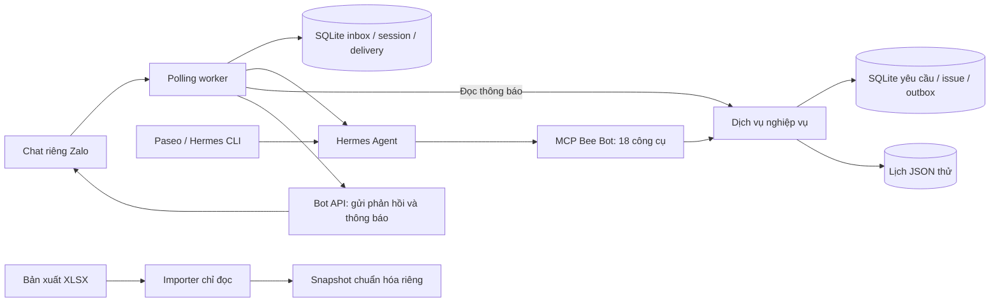

# Bee Bot

Trợ lý vận hành labcoach cho chương trình AI thực chiến 20K của VinGroup phối hợp với VinUni. Bee Bot dùng **Hermes Agent** để xử lý hội thoại và gọi công cụ nghiệp vụ qua **MCP**, hỗ trợ thay đổi lịch, theo dõi sự cố phòng học và tra cứu thông tin qua chat riêng.

**Phiên bản:** `0.1.0` · **Trạng thái:** prototype, chưa mở pilot production.

## Tính năng

| Luồng | Hành vi |
| --- | --- |
| Nhận thay | Người gửi đề xuất người thay; người thay xác nhận trực tiếp trước khi cập nhật phân công. |
| Hoán đổi | Hai labcoach xác nhận đổi hai vị trí; hệ thống kiểm tra lịch và đối chiếu kết quả cả hai vị trí sau ghi. |
| Xin nghỉ | Vận hành chấp nhận trước khi bot mời các ứng viên hợp lệ; người đủ điều kiện xác nhận đầy đủ đầu tiên nhận vị trí. |
| Báo sự cố | Ghi nhận sự cố phòng học, cập nhật tiến độ và lưu kết quả xử lý. |
| Tra cứu | Xem lịch cá nhân, yêu cầu, lời mời, sự cố và thông báo theo quyền. |

Các quy tắc chính:

- Danh tính và quyền lấy từ cấu hình tin cậy; model không tự chọn actor hoặc vai trò.
- Bot kiểm tra trùng lịch chương trình; người nhận phải tự xác nhận không bận ngoài chương trình.
- Lời mời hết hạn sau tối đa 24 giờ, không muộn hơn lúc ca bắt đầu.
- Khi đổi phân công tương ứng cột D, hệ thống giữ nguyên thông tin xếp ca tương ứng cột J.
- Yêu cầu nghỉ đang chờ duyệt có thể bổ sung người thay: giữ mã yêu cầu, báo vận hành và chuyển sang luồng nhận thay.
- Sự kiện được chống lặp; kết quả ghi hoặc gửi chưa rõ cần đối chiếu trước khi xử lý tiếp.

Chi tiết nằm trong [đặc tả luồng nghiệp vụ](docs/WORKFLOW_SPEC_V1_DRAFT.md).

## Kiến trúc



Hermes xử lý ngôn ngữ và gọi công cụ; dịch vụ Python kiểm tra quyền, điều kiện nghiệp vụ và quyết định kết quả cập nhật. SQLite lưu trạng thái bền; lịch JSON mô phỏng dữ liệu Sheets trong bản thử. Importer XLSX tạo snapshot riêng, không sửa workbook nguồn.

Endpoint webhook Starlette là phương án nhận riêng: xác thực và lưu inbox trước khi trả ACK. Hiện chưa có worker production xử lý webhook hoàn chỉnh; polling chỉ chạy khi bot không có webhook.

| Thành phần | Công nghệ |
| --- | --- |
| Runtime và đóng gói | Python ≥ 3.11, uv, Hatchling |
| Agent và giao diện | Hermes Agent; Paseo tùy chọn |
| Công cụ agent | MCP Python SDK, stdio |
| Lưu trữ | SQLite, JSON có file lock cục bộ |
| Tích hợp | Zalo Bot API qua HTTPX; XLSX qua openpyxl |
| HTTP nhận sự kiện | Starlette, Uvicorn |
| Kiểm thử | pytest |

## Yêu cầu môi trường

- Linux hoặc macOS: lịch JSON và worker dùng `fcntl` của hệ điều hành POSIX.
- Python 3.11 trở lên và `uv`.
- Để chat: Hermes đã cài, lệnh `hermes` có trong `PATH`, model/provider và xác thực đã được cấu hình.
- Để dùng Paseo: Paseo đã cài và có cấu hình daemon.
- Để thử Zalo: Bot Token, tài khoản thử đã liên kết và kết nối mạng.

Chạy CLI nghiệp vụ và kiểm thử tự động không cần Hermes, Bot Token hoặc quyền Google Sheets.

## Cài đặt và chạy nhanh

```bash
git clone https://github.com/Nguyenthanhduy16/Bee_bot.git
cd Bee_bot
uv sync --locked --extra dev

# Tạo lịch giả cho 5 persona, với các ca tương đối theo ngày khởi tạo
.venv/bin/bee-bot init-demo

# Xem lịch và tra lịch cá nhân trực tiếp qua dịch vụ
.venv/bin/bee-bot show-schedule
.venv/bin/bee-bot call get_my_assignments --actor an
```

Các persona thử: `an`, `binh`, `chi`, `dung` và `ops`. CLI chọn actor phục vụ phát triển cục bộ; đây không phải cơ chế xác thực người dùng production.

`init-demo` giữ nguyên lịch đã tồn tại. Để tạo kịch bản sạch, dùng một thư mục trạng thái mới cho toàn bộ thành phần liên quan:

```bash
.venv/bin/bee-bot --state-dir .bee-bot/demo-new init-demo
.venv/bin/bee-bot --state-dir .bee-bot/demo-new show-schedule
```

## Sử dụng qua Hermes và Paseo

Sau khi cấu hình model/provider trong Hermes, tạo profile Bee Bot:

```bash
.venv/bin/python scripts/setup_hermes_profiles.py
scripts/hermes-bee-bot an
```

Script tạo hoặc cập nhật 5 profile `bee-bot-<actor>` với actor cố định và cùng lịch/DB. Script ghi cấu hình các profile Bee Bot; chỉ lấy lựa chọn model từ profile gốc, không sao chép credential hoặc memory. Nếu dùng thư mục trạng thái khác, truyền `--state-dir` cho script.

Ví dụ tin nhắn:

```text
Xem lịch của tôi.
Tôi muốn nhờ Bình nhận thay ca A001.
Báo sự cố: Wi-Fi phòng A101 không hoạt động.
```

Bot cần lấy đủ thông tin và xác nhận trước khi thực hiện thao tác. Người nhận dùng profile của chính mình để phản hồi lời mời.

Để thêm provider vào Paseo:

```bash
.venv/bin/python scripts/setup_paseo.py
paseo daemon reload --json
```

Script giữ các provider hiện có và lưu backup cấu hình Paseo. Nếu CLI Paseo chưa nằm trong `PATH`, dùng đường dẫn executable của bản cài. Không mở đồng thời nhiều phiên điều khiển cùng một profile.

Xem [hướng dẫn Hermes/Paseo](docs/HERMES_LOCAL_SETUP.md) và [mẫu cấu hình MCP](examples/hermes-config.yaml).

## Cấu hình

| Biến | Mục đích / mặc định |
| --- | --- |
| `BEE_BOT_ACTOR_ID` | Actor cố định của MCP; bắt buộc và phải đang hoạt động. |
| `BEE_BOT_DATA_DIR` | Thư mục mặc định của MCP; `.bee-bot`. |
| `BEE_BOT_DB` | Đường dẫn DB nghiệp vụ; mặc định `<data-dir>/state.db`. |
| `BEE_BOT_SCHEDULE` | Đường dẫn lịch JSON; mặc định `<data-dir>/schedule.json`. |
| `BEE_BOT_EVENT_ID` | Context sự kiện do adapter truyền để chống lặp mutation; không do model cung cấp. |
| `ZALO_BOT_TOKEN` | Token gọi Bot API. |
| `ZALO_WEBHOOK_SECRET` | Secret xác thực ingress, dài 8–256 ký tự; bản worker cũng yêu cầu giá trị này. |
| `BEE_BOT_ZALO_IDENTITIES` | Đường dẫn JSON ánh xạ sender ID Zalo → person ID. |
| `BEE_BOT_ZALO_INBOX` | Đường dẫn inbox; worker mặc định dùng `<state-dir>/zalo-inbox.db`. |

CLI dùng `--state-dir`; các profile MCP phải trỏ tới cùng lịch và DB với phiên thử tương ứng. Dùng đường dẫn tuyệt đối trong cấu hình profile và tệp liên kết danh tính.

Token, secret, liên kết danh tính và dữ liệu cá nhân được lưu ngoài Git. `.bee-bot/`, `.venv/` và các tệp `.env` được bỏ qua trong [`.gitignore`](.gitignore); cấu hình mẫu không chứa credential.

## Tích hợp Zalo

### Polling với Hermes

Chuẩn bị bot và profile Hermes theo [hướng dẫn onboarding](docs/ZALO_ONBOARDING.md). Khi chưa có tệp cấu hình, tạo cấu hình riêng từ mẫu:

```bash
mkdir -p .bee-bot
cp examples/zalo.env.example .bee-bot/zalo.env
chmod 600 .bee-bot/zalo.env
```

Điền token, secret và đường dẫn tệp JSON liên kết đã xác thực. Mỗi actor thử được liên kết với đúng một sender ID; tên hiển thị hoặc lời tự khai trong chat không cấp quyền. Hướng dẫn onboarding có quy trình liên kết bằng mã riêng dùng một lần.

Sau khi cấu hình và liên kết, kiểm tra API rồi chạy worker với lịch thử riêng:

```bash
.venv/bin/python scripts/zalo_onboard.py check --env-file .bee-bot/zalo.env
.venv/bin/bee-bot --state-dir .bee-bot/zalo-demo init-demo
.venv/bin/python -m bee_bot.zalo_worker \
  --env-file .bee-bot/zalo.env --state-dir .bee-bot/zalo-demo
```

Worker đọc tệp env khi có `--env-file`, tạo một profile `bee-zalo` dùng chung và giữ session riêng theo sender. Danh tính được lấy từ liên kết Zalo đã xác thực, truyền vào từng lần chạy Hermes để MCP kiểm tra quyền; tên hoặc vai tự khai trong chat không cấp quyền. Khi chuyển từ profile `bee-zalo-<actor>` cũ, session cũ được giữ nguyên để tra cứu và mỗi sender bắt đầu session mới trong profile chung. Worker dừng nếu webhook đang hoạt động hoặc profile Zalo có cấu hình khác. Người thử cần nhắn bot để xác minh chat nhận thông báo. Trạng thái `sent` nghĩa API xác nhận gửi.
Tên hiển thị Zalo chỉ dùng để xưng hô; tên persona trong lịch JSON là vai thử, không phải danh tính thật của người đang chat.

Profile `bee-zalo` cần worker truyền actor/event/tên hiển thị cho từng tin. Mở lịch sử phiên trong ứng dụng Hermes để xem được, nhưng nhắn tiếp trực tiếp tại đó không có danh tính Zalo và có thể làm MCP báo `INVALID_ACTOR`. Kiểm tra danh tính bằng tin mới gửi từ Zalo. Worker chấp nhận metadata phiên bản và endpoint/chế độ API Hermes tự bổ sung nếu khớp cấu hình model gốc; thay đổi actor, đường dẫn dữ liệu hoặc công cụ vẫn bị từ chối.

Session do worker tạo có tiêu đề `Zalo · <tên hiển thị> — <nội dung hội thoại>` để danh sách và đầu khung chat Hermes nhận diện người nhắn. Tên mới cập nhật theo tin Zalo; nếu thiếu tên, giữ tên đã nhận trước đó hoặc dùng nhãn người dùng ổn định. Metadata hiển thị lưu trong DB profile riêng, không thay đổi quyền hoặc định tuyến chat. Lỗi cập nhật nhãn không làm mất phản hồi và không tự phát lại thao tác nghiệp vụ.

Profile chung chỉ tải toolset `bee_bot`; skill chung và bộ nhớ tự động không được nạp. Hướng dẫn nghiệp vụ nằm trong SOUL quản lý. Worker kiểm tra config/SOUL trước khi nhận tin; profile cũ cần chuyển đổi tường minh bằng `.venv/bin/python -m bee_bot.zalo_worker --migrate-profile --state-dir .bee-bot/zalo-demo` (sao lưu hai file, không gọi Zalo/model). Xem [nghiệm thu hai sender](docs/ZALO_TWO_SENDER_ACCEPTANCE.md) trước lượt thử tiếp theo.

### Webhook nhận cục bộ

Sau khi export `ZALO_WEBHOOK_SECRET`, `BEE_BOT_ZALO_IDENTITIES` và `BEE_BOT_ZALO_INBOX`:

```bash
.venv/bin/uvicorn bee_bot.zalo_webhook:app_from_env \
  --factory --host 127.0.0.1 --port 8765
```

- `POST /zalo/webhook`: xác thực header `X-Bot-Api-Secret-Token`, lưu sự kiện bền trước ACK.
- `GET /health`: kiểm tra tiến trình HTTP phản hồi; không kiểm tra Hermes hoặc kết nối Zalo.

Endpoint nhận không cần Bot Token và không gọi model hay gửi phản hồi. Để triển khai webhook thật cần HTTPS công khai và worker xử lý riêng. Xem [tài liệu adapter](examples/ZALO_ADAPTER.md).

## Import lịch và bảo trì

```bash
# Chuẩn hóa bản xuất XLSX vào snapshot riêng, không sửa nguồn
.venv/bin/bee-bot import-xlsx .bee-bot/source/schedule.xlsx \
  --output .bee-bot/source/normalized.json

# Đối chiếu yêu cầu, xử lý hết hạn và tạo tổng hợp
.venv/bin/bee-bot worker --once

# Chạy bảo trì liên tục, mỗi 30 giây
.venv/bin/bee-bot worker --interval 30
```

Importer đọc nguồn B–J, xử lý ô gộp và chuẩn hóa ca sáng 09:00–13:00, chiều 14:00–18:00. Snapshot có định danh tạm, danh tính chưa xác thực và không tự trở thành lịch được phép ghi. Đối chiếu chi tiết trong [ánh xạ Sheets](docs/SHEETS_MAPPING_V1_DRAFT.md).

Lệnh `worker` của CLI phục vụ bảo trì nghiệp vụ; `bee_bot.zalo_worker` phục vụ hội thoại và giao nhận Zalo. Các tiến trình hiện cần được khởi chạy và quản lý bên ngoài ứng dụng.

## Kiểm thử

```bash
.venv/bin/python -m pytest -q
```

Bộ kiểm thử bao gồm nghiệp vụ, phân quyền, chống lặp, cạnh tranh nhận ca, lỗi ghi một phần, phục hồi sau restart, MCP stdio, importer, webhook, polling, onboarding và nội dung thông báo. Các kiểm thử tự động dùng dữ liệu giả và mock transport/model, không gọi Zalo hoặc Google Sheets thật.

[Báo cáo nghiệm thu ngày 10/10/2026](docs/ACCEPTANCE_REPORT_V1.md) ghi nhận **140 test đạt**, thử đủ 5 luồng qua Hermes/Paseo trên lịch giả và một lượt tra lịch qua Zalo thật được API xác nhận gửi phản hồi.
[Mốc profile Hermes chung ngày 11/10/2026](docs/SHARED_HERMES_PROFILE_2026-10-11.md) ghi nhận một lượt tra lịch thật qua profile `bee-zalo` và xác nhận người dùng đã nhìn thấy phản hồi.

## Cấu trúc repository

```text
src/bee_bot/
├── service.py           # Luồng nghiệp vụ, quyền và đối chiếu kết quả
├── store.py             # Trạng thái nghiệp vụ và outbox SQLite
├── schedule.py          # Lịch JSON, snapshot và mô phỏng lỗi ghi
├── sheets_import.py     # Import XLSX chỉ đọc
├── fixtures.py          # Dữ liệu demo
├── mcp_server.py        # Công cụ MCP cho Hermes
├── zalo.py              # Bot API client và inbox ingress
├── zalo_webhook.py      # HTTP nhận webhook
├── zalo_worker.py       # Polling, Hermes session và giao nhận
├── notification_text.py # Nội dung thông báo theo quyền
└── cli.py               # Lệnh phát triển và bảo trì
tests/                  # Kiểm thử tự động
scripts/                # Cấu hình Hermes/Paseo và onboarding
examples/               # Cấu hình, SOUL và skill mẫu
docs/                   # Đặc tả, thiết kế và báo cáo nghiệm thu
```

## Giới hạn và điều kiện triển khai

- Chưa có adapter ghi Google Sheets thật; file lock và kiểm tra snapshot chỉ bảo vệ lịch JSON cục bộ.
- Chưa nghiệm thu đổi lịch/sự cố qua Zalo thật, webhook công khai hoặc quyền nhắn chủ động cho đầy đủ người dùng pilot.
- Chưa có dịch vụ nền tự phục hồi, dashboard đối chiếu giao nhận hoặc cơ chế tự xử lý kết quả gửi chưa rõ.
- Bản thử dùng đệm di chuyển 0 phút; độ bao phủ nguồn lịch và liên kết danh tính labcoach thật cần được xác nhận.
- Profile demo dành cho chủ máy tin cậy, chưa cung cấp cách ly người dùng production.

Điều kiện mở pilot và trách nhiệm nghiệm thu nằm trong [kế hoạch triển khai](docs/LEAD_PLAN.md). Kết quả kiểm thử cục bộ không thay thế nghiệm thu nghiệp vụ và tích hợp thật.

## Tài liệu liên quan

| Tài liệu | Nội dung |
| --- | --- |
| [MVP v1](docs/MVP_V1.md) | Phạm vi và quy tắc nghiệp vụ |
| [Các quyết định đã chốt](docs/DECISIONS_TO_START_V1.md) | Quyết định để bắt đầu triển khai |
| [Hợp đồng triển khai](docs/IMPLEMENTATION_CONTRACT_V1.md) | Giao diện giữa các thành phần |
| [Thiết kế Hermes](docs/HERMES_DEPLOYMENT_V1_DRAFT.md) | Phương án kiến trúc và triển khai |
| [Mẫu tin nhắn](docs/MESSAGE_EXAMPLES_V1_DRAFT.md) | Hội thoại và thông báo nghiệp vụ |
| [Nghiên cứu nút Zalo](docs/ZALO_BUTTON_RESEARCH.md) | Khả năng nền tảng và phương án xác nhận |

## Đóng góp

Đọc đặc tả và hợp đồng triển khai trước khi sửa luồng nghiệp vụ. Giữ việc kiểm tra quyền và quyết định cập nhật ở dịch vụ; không bổ sung công cụ cho model tự chọn danh tính hoặc sửa ô tùy ý. Với thay đổi hành vi, cập nhật kiểm thử liên quan và tài liệu, rồi chạy bộ kiểm thử trước khi gửi PR. Chia commit theo task và giữ credential, dữ liệu cá nhân, dữ liệu runtime ngoài Git.
