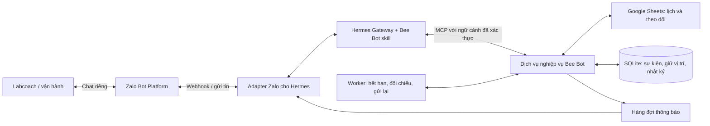

# Bee Bot — Thiết kế và hướng dẫn triển khai bằng Hermes Agent

- **Ngày:** 10/10/2026.
- **Định hướng đã chọn:** triển khai Bee Bot thông qua Hermes Agent.
- **Phạm vi tài liệu:** thiết kế kiến trúc pilot. Bản thử cục bộ đã có mã nghiệp vụ/MCP và được nối Hermes thật qua Paseo; chưa nối Sheets ghi thật hoặc Zalo chạy thật.
- **Trạng thái:** kiến trúc pilot đang hoàn thiện; xem [hướng dẫn bản chạy](HERMES_LOCAL_SETUP.md) và [báo cáo nghiệm thu](ACCEPTANCE_REPORT_V1.md) để phân biệt phần đã hoạt động với đề xuất bên dưới.
- **Căn cứ:** [MVP v1](MVP_V1.md), [luồng và dữ liệu](WORKFLOW_SPEC_V1_DRAFT.md), [ánh xạ Sheets](SHEETS_MAPPING_V1_DRAFT.md).
- Hermes trong tài liệu này là [NousResearch/hermes-agent](https://github.com/NousResearch/hermes-agent).

**Môi trường hiện có được xác nhận:** người phụ trách đã cài Hermes và thử ra lệnh qua Paseo. Kiểm tra ngày 10/10/2026 thấy Hermes `v0.21.6+387.gdce1e9b`, bản cài tại `/home/duy/.hermes/hermes-agent`, cùng tiến trình Hermes chạy ACP do Paseo khởi chạy tại thư mục Bee_Bot. Không đọc/hiển thị secret và chưa gọi model trong lần kiểm tra này. Có bản cài và phiên ACP chưa đồng nghĩa đã có công cụ nghiệp vụ Bee Bot. Trạng thái chưa triển khai ở đầu tài liệu nói về Bee Bot, không phải Hermes trên máy.

## 1. Vai trò của Hermes

Hermes đảm nhiệm hiểu tin nhắn tiếng Việt, hỏi bổ sung, giữ ngữ cảnh hội thoại và gọi công cụ. Bee Bot cần phần nghiệp vụ để xác thực người dùng, kiểm tra ca, lưu xác nhận, giữ vị trí cho người nhận đầu tiên và cập nhật Sheets đúng quy tắc.

Đề xuất cung cấp công cụ cho từng thao tác như tạo yêu cầu, trả lời lời mời và tra cứu trạng thái. Mỗi công cụ tự kiểm tra quyền và điều kiện; trả kết quả có cấu trúc cho Hermes diễn đạt. Memory của agent phục vụ hội thoại, không làm nguồn trạng thái nghiệp vụ. Agent không được cung cấp công cụ ghi ô Sheets tùy ý.

[Hermes hỗ trợ MCP](https://hermes-agent.nousresearch.com/docs/user-guide/features/mcp) để gọi công cụ bên ngoài và [skills](https://hermes-agent.nousresearch.com/docs/user-guide/features/skills/) để nạp hướng dẫn theo tác vụ. Đề xuất xây MCP Bee Bot riêng, kèm skill tiếng Việt về hội thoại và cách diễn giải kết quả. Nghiệp vụ Labcoach chưa có sẵn trong Hermes.

## 2. Kiến trúc đề xuất



| Thành phần | Trách nhiệm |
| --- | --- |
| Adapter Zalo | Xác minh tin đến theo cơ chế webhook của Zalo, chống nhận trùng, xác định người gửi/cuộc chat, chuyển sự kiện vào Hermes; gửi phản hồi và thông báo |
| Hermes | Hiểu ý định, hỏi thông tin thiếu, gọi công cụ, trả lời tiếng Việt từ kết quả đã kiểm tra |
| Skill Bee Bot | Hướng dẫn hội thoại và mẫu phản hồi; không cấp quyền hoặc thay thế kiểm tra trong mã |
| Dịch vụ nghiệp vụ | Ánh xạ Zalo với mã labcoach đã xác thực, phân quyền, xử lý trạng thái, kiểm tra lịch, lưu xác nhận, chọn người nhận, ghi và kiểm tra Sheets |
| SQLite | Sổ xử lý kỹ thuật: sự kiện đã nhận, thứ tự phản hồi, giữ vị trí, thao tác đang ghi, nhật ký và tin chưa gửi; đề xuất cho pilot một máy/một dịch vụ ghi |
| Worker | Kiểm tra hết hạn, đối chiếu lỗi ghi chưa rõ kết quả, đọc thay đổi vận hành trên Sheets và gửi thông báo trong hàng đợi |

Google Sheets tiếp tục là lịch chính thức và nơi vận hành theo dõi yêu cầu/issue. SQLite không tạo lịch chính thức thứ hai. Cần xác định cột nào vận hành sửa và cột nào bot quản lý theo [đặc tả dữ liệu](WORKFLOW_SPEC_V1_DRAFT.md#5-mô-hình-dữ-liệu-để-đối-chiếu-google-sheets); không đồng bộ hai chiều mọi cột bằng cách ghi đè bản mới nhất.

Với quy mô pilot 30–40 người, đề xuất một máy Linux luôn bật. Nếu chạy nhiều máy, phải đánh giá lại SQLite, khóa và hàng đợi.

## 3. Kết nối Zalo

Trong [tài liệu gateway](https://hermes-agent.nousresearch.com/docs/user-guide/messaging/) và [danh sách adapter chính thức đã kiểm tra](https://hermes-agent.nousresearch.com/docs/developer-guide/gateway-internals), chưa thấy Zalo. Lệnh `hermes gateway setup` chưa đủ để kết nối Bee Bot với Zalo.

Hermes có cơ chế platform adapter dựa trên `BasePlatformAdapter`. Đề xuất viết adapter/plugin Zalo theo phiên bản Hermes được ghim khi triển khai, chuẩn hóa tin đến thành sự kiện gateway và gửi phản hồi qua API Zalo. Cách đăng ký plugin, định tuyến phiên riêng và truyền danh tính vào công cụ cần được kiểm chứng trên phiên bản đó. Đây là thiết kế, chưa có plugin chạy được.

[Zalo hỗ trợ getUpdates](https://bot.zapps.me/docs/apis/getUpdates/) hoặc webhook, hai cách loại trừ nhau. Polling dùng khi phát triển; tài liệu Zalo khuyến nghị webhook cho production. Pilot thật cần endpoint HTTPS, xác thực webhook theo tài liệu Zalo và lưu sự kiện bền vững trước khi trả lời nhận thành công. Không giữ request webhook chờ LLM hoàn thành hội thoại.

[sendMessage](https://bot.zapps.me/docs/apis/sendMessage/) nhận `chat_id` và `text`, giới hạn 1–2.000 ký tự. Adapter cần chia tin dài, giữ thứ tự và xử lý lỗi/hạn mức. Đề xuất thử phản hồi chữ; nút bấm vẫn theo [nghiên cứu Zalo](ZALO_BUTTON_RESEARCH.md), chưa chốt.

Cần thử tạo bot, lấy đúng ID người gửi và khả năng nhắn chủ động trên tài khoản dự án. Giữ kênh Zalo đã chốt; không mặc định chuyển người dùng sang Telegram để thuận tiện tích hợp Hermes.

## 4. Công cụ nghiệp vụ cần xây

Các tên dưới đây là API đề xuất, chưa được cài đặt hoặc đăng ký với Hermes.

| Công cụ | Mục đích và điều kiện |
| --- | --- |
| `get_my_assignments` | Trả phân công của người đang chat trong phạm vi lịch đã cấu hình |
| `create_change_request` | Tạo nghỉ/nhận thay/hoán đổi; kiểm tra phân công thuộc người gửi; sự kiện lặp không tạo thêm bản ghi |
| `get_request_status` | Tra cứu theo quyền; người được mời chỉ thấy nội dung cần cho lời mời, vận hành có quyền theo dõi chung |
| `approve_leave_request` | Chỉ vận hành được cấp quyền; lưu chấp nhận trước khi phát lời mời tìm người |
| `nominate_replacement` | Vận hành đề cử người; vẫn cần xác nhận trực tiếp của người nhận |
| `get_my_invitations` | Hiển thị lời mời của đúng người nhận |
| `respond_to_invitation` | Lưu đồng ý/từ chối và xác nhận không bận ngoài chương trình cho đúng ca/phiên bản; xét điều kiện và giữ vị trí bằng giao dịch |
| `cancel_request` | Kiểm tra quyền/trạng thái; đối chiếu trước nếu đang ghi hoặc chưa rõ kết quả |
| `create_issue` | Lưu phòng, mô tả, thời điểm phát hiện, ảnh nếu có và tạo mã theo dõi |
| `get_issue_status` | Tra cứu theo quyền từ trạng thái đã ghi nhận |

Việc đổi D do dịch vụ nghiệp vụ thực hiện khi đủ điều kiện, không dựa vào quyết định của mô hình hoặc tham số `force`.

**Danh tính:** adapter lấy người gửi từ sự kiện Zalo đã xác minh. Cầu nối công cụ gắn ngữ cảnh đã xác thực cho từng lượt, hoặc token ngắn hạn gắn người và sự kiện. Công cụ không tin `actor_id`, `role` hay `chat_id` do mô hình tự điền. Header MCP tĩnh theo profile không tự đại diện cho từng người Zalo khi nhiều người dùng chung gateway; phần truyền ngữ cảnh này cần thử trước khi mở ghi.

**Xác nhận:** lưu ID tin nhắn, người gửi, thời điểm tiếp nhận và phiên bản lời mời/ca. Câu trả lời chưa rõ phải hỏi lại. Đề xuất pilot dùng xác nhận rõ kèm mã lời mời, chẳng hạn “Nhận LM-000123, tôi không có lịch bận khác trong ca này”; cú pháp cuối cùng còn cần rà soát. Lời kể “Bình đã đồng ý” của người tạo yêu cầu không trở thành xác nhận của Bình.

## 5. Kiểm soát lịch và trạng thái

Giữ quy tắc đã chốt: D là phân công chính thức; B–J là nguồn chuẩn; giữ nguyên J; sáng 09:00–13:00, chiều 14:00–18:00; liên kết Zalo được vận hành xác thực và người nhận tự xác nhận không bận ngoài chương trình.

Trước ghi, đọc lại lịch, đối chiếu mã phân công ổn định, nội dung ca và người cũ ở D. Không dùng số dòng làm định danh duy nhất. Kiểm tra toàn bộ danh mục lịch chương trình đã cấu hình và cả vị trí đang giữ trong thao tác chưa hoàn tất để tránh nhận hai ca trùng nhau qua hai yêu cầu.

Với lượt mời đồng thời, đề xuất gán thứ tự tiếp nhận bền vững cho phản hồi và xử lý xét điều kiện theo thứ tự đó. Người có đủ xác nhận và vượt kiểm tra đầu tiên được giữ vị trí trong giao dịch; tốc độ LLM xử lý không quyết định người thắng. Cách xác định thứ tự này cần rà soát với quy tắc “người đủ điều kiện sớm nhất”.

**Quyền cập nhật đã chốt:** cả vận hành và bot đều được sửa D trực tiếp; không bắt buộc đưa mọi thay đổi của vận hành qua dịch vụ ghi. Bot đọc lại trước ghi, đối chiếu ca/vị trí, người gốc ở D, nội dung đã xác nhận và lịch liên quan. Phát hiện thay đổi ảnh hưởng yêu cầu thì dừng ghi theo bản cũ và đối chiếu lại; còn đủ điều kiện thì ghi đúng D, giữ J và đọc lại để xác minh.

**Sửa đồng thời trên Sheets — giới hạn còn cần kiểm chứng:** khóa SQLite chỉ bảo vệ các thao tác của bot, không khóa người sửa trực tiếp. Đọc trước và xác minh sau không loại bỏ trường hợp vận hành sửa giữa hai bước; giá trị do vận hành sửa rồi bị bot ghi đè có thể không được phát hiện chỉ từ lần đọc sau. Với API [values.update](https://developers.google.com/workspace/sheets/api/reference/rest/v4/spreadsheets.values/update), tài liệu mô tả ghi giá trị theo range, không cung cấp tham số so sánh giá trị cũ trong thao tác đó; vì vậy không coi cặp đọc/ghi là phép cập nhật có điều kiện nguyên tử. Đây là suy luận từ giao diện API, chưa phải kết quả thử nghiệm. Cần thử sửa D trước/giữa/sau thao tác bot, ghi rõ giới hạn và đề xuất cách phối hợp trước pilot. Khi phát hiện xung đột hoặc kết quả chưa rõ, giữ yêu cầu chưa hoàn tất, báo vận hành và đối chiếu trước khi thử lại; không tự ghi lại hoặc hoàn nguyên theo bản cũ.

Hoán đổi ghi hai ô D trong cùng yêu cầu API nếu khả năng đó đã được kiểm chứng, lưu nhật ký ý định và đọc lại cả hai ô. Lệnh batch không tự khóa người sửa Sheets hoặc chứng minh thành công khi timeout. Kết quả chưa rõ thì giữ người đã được chọn và trạng thái đang đối chiếu; không tự ghi lại, hoàn nguyên hay giao vị trí cho người khác.

Hết hạn tại `min(thời điểm phát hành + 24 giờ, thời điểm ca bắt đầu)`; hoán đổi lấy ca bắt đầu sớm hơn. Công cụ kiểm tra hạn khi nhận xác nhận, kể cả worker chưa chạy. Dùng `Asia/Ho_Chi_Minh` khi diễn giải ngày giờ.

Chỉ báo hoàn tất khi Sheets đã đúng và đọc lại xác minh. Lỗi gửi tin giữ kết quả nghiệp vụ, đưa tin vào hàng đợi gửi lại. Timeout gửi tin có thể có kết quả không rõ; không hứa tuyệt đối không gửi trùng nếu nền tảng chưa có cơ chế hỗ trợ.

## 6. Trình tự triển khai

**Mốc bàn giao đầu tiên được làm rõ:** người phụ trách dùng Paseo để chat với Hermes thật đã nạp công cụ Bee Bot trên dữ liệu giả. Sheets và Zalo được giả lập để chưa cần tài khoản hai nền tảng này. Tận dụng kết nối Paseo–Hermes hiện có; cần kiểm chứng cấu hình MCP/công cụ Bee Bot trong phiên ACP và truyền danh tính từng vai thử. Phải có bằng chứng gọi công cụ qua Hermes/model thật trước khi báo đạt mốc này. Paseo là giao diện thử; Zalo vẫn là kênh người dùng khi mở pilot.

1. **Chuẩn bị Hermes đã cài:** ghi phiên bản hiện có, kiểm chứng provider/model và cấu hình công cụ; tạo profile Bee Bot riêng trên bản cài hiện có và thử qua Paseo với dữ liệu giả. Không cài lại hoặc nâng cấp Hermes mặc định; không thay cấu hình phiên cá nhân đang hoạt động. Tài liệu ACP/profile của bản cài là căn cứ kiểm chứng cách nạp MCP và tách cấu hình.
2. **Dựng nghiệp vụ:** bổ sung mã ca/phân công ổn định, danh sách liên kết, bảng theo dõi; xây bộ đọc ô gộp và dịch vụ ghi. Phát triển trên bản sao Sheets.
3. **Kết nối Hermes:** xây MCP và skill Bee Bot; thử đọc lịch, tạo yêu cầu, tra cứu và lời mời nhiều người; kiểm chứng danh tính đến tận công cụ.
4. **Kết nối Zalo:** xây adapter theo phiên bản ghim; thử webhook, sự kiện lặp, phiên riêng, thông báo cho người không đang chat và hạn mức tài khoản.
5. **Mở pilot:** chạy đọc/ghi nhận trước; bật tự ghi D sau khi nghiệm thu quyền, xác nhận, trùng lịch, giữ vị trí và đối chiếu lỗi. Chạy worker và thử phục hồi sau khởi động lại máy.

Các lệnh chuẩn từ [Hermes README](https://github.com/NousResearch/hermes-agent) và [tài liệu gateway](https://hermes-agent.nousresearch.com/docs/user-guide/messaging/) dưới đây là tham khảo cho máy Linux mới chưa có Hermes. Máy hiện tại đã cài nên tận dụng bản cài có sẵn; không thực hiện lại bước cài đặt theo mặc định. Các lệnh này chưa cài phần Bee Bot/Zalo:

```bash
# Trình cài chính thức; ghi nhận và ghim phiên bản dùng cho pilot.
curl -fsSL https://hermes-agent.nousresearch.com/install.sh -o /tmp/hermes-install.sh
bash /tmp/hermes-install.sh

# Mở shell mới sau khi cài để nạp PATH.
hermes setup
hermes doctor

# Sau khi đã cài và cấu hình adapter Bee Bot/Zalo.
hermes gateway
```

Sau khi foreground chạy thành công, trên máy Linux luôn bật có thể cài dịch vụ:

```bash
sudo hermes gateway install --system
sudo hermes gateway start --system
sudo hermes gateway status --system
```

Dùng môi trường Bee Bot và chủ dịch vụ phù hợp; không chạy hai gateway cùng nhận một bot. Dịch vụ nghiệp vụ/worker và endpoint HTTPS phải triển khai riêng. Gateway không tự tạo các thành phần này. Khi dựng thật, lưu phiên bản Hermes và cấu hình đã thử để có thể tái lập/khôi phục; không tự cập nhật bản mới ngay trên pilot.

## 7. Thông tin cần có trước khi chạy thật

- Máy/VPS và tên miền hoặc phương án HTTPS webhook.
- Bot Zalo tạo được, token, quyền nhắn chủ động và hạn mức thực tế.
- Provider/model và thông tin truy cập cho Hermes.
- Quyền API Sheets; danh mục workbook/tab/kỳ lịch đầy đủ; mã ca/phân công ổn định.
- Danh sách mã labcoach ↔ tài khoản Zalo đã xác thực; danh sách vận hành và người nhận thông báo.
- Cột vận hành chấp nhận nghỉ/cập nhật issue; lịch tổng hợp và quy trình cùng sửa D trực tiếp, đối chiếu xung đột.

Thông tin truy cập được cấu hình ngoài Git. Sao lưu SQLite, cấu hình Hermes và ánh xạ mã; thử phục hồi cả thao tác chưa rõ kết quả lẫn tin đang chờ gửi. Repo đã có runtime thử cục bộ; tài liệu kiến trúc này không đồng nghĩa pilot Zalo/Sheets thật đã hoạt động.

## 8. Nghiệm thu tích hợp

Dùng [kịch bản nghiệp vụ hiện có](WORKFLOW_SPEC_V1_DRAFT.md#8-kịch-bản-nghiệm-thu-nghiệp-vụ-đề-xuất), bổ sung:

- Hai người chat cùng lúc không thấy lịch riêng hoặc xác nhận thay nhau; tin nhắn/tham số giả mạo vai trò bị từ chối.
- Nhiều ứng viên đồng ý gần nhau: thứ tự tiếp nhận rõ ràng, một người giữ vị trí; không chọn theo lượt LLM hoàn thành trước.
- Tin Zalo lặp/khởi động lại không tạo yêu cầu mới hoặc ghi D lần hai; phục hồi sự kiện đã nhận và tin chưa gửi.
- Ca đổi sau lời mời cần xác nhận mới; lời mời quá hạn bị chặn ngay tại công cụ.
- Vận hành sửa J khi bot đổi D: giữ giá trị J mới. Vận hành sửa D trước bot ghi: phát hiện thay đổi ảnh hưởng yêu cầu và dừng ghi theo bản cũ. Thử thêm sửa D giữa/sau thao tác bot để đánh giá khả năng phát hiện và giới hạn ghi đè, không tuyên bố khóa được người sửa trực tiếp.
- Timeout ghi/hoán đổi: đối chiếu trước thử lại; không báo hoàn tất một nửa.
- Worker nhận đúng thay đổi chấp nhận nghỉ/trạng thái issue trên Sheets và thông báo từ dữ liệu đã lưu.
- Hết hạn mức/gửi tin lỗi: giữ trạng thái nghiệp vụ, ghi nhận tin còn chờ và báo vận hành theo kênh đã cấu hình.

## 9. Nguồn kiểm tra ngày 10/10/2026

- [Hermes Agent — mã nguồn và cài đặt](https://github.com/NousResearch/hermes-agent).
- [Hermes Gateway](https://hermes-agent.nousresearch.com/docs/user-guide/messaging/) — lệnh chạy và dịch vụ.
- [Gateway Internals](https://hermes-agent.nousresearch.com/docs/developer-guide/gateway-internals) — luồng sự kiện và adapters.
- [Hermes MCP](https://hermes-agent.nousresearch.com/docs/user-guide/features/mcp) và [Skills](https://hermes-agent.nousresearch.com/docs/user-guide/features/skills/) — công cụ và hướng dẫn theo tác vụ.
- [Zalo getUpdates](https://bot.zapps.me/docs/apis/getUpdates/) và [sendMessage](https://bot.zapps.me/docs/apis/sendMessage/) — nhận/gửi tin.

Các nguồn chứng minh điểm mở rộng của Hermes và API Zalo. Adapter Bee Bot, ngữ cảnh danh tính và nghiệp vụ vẫn cần xây/thử; repo chưa có bằng chứng chạy end-to-end.
